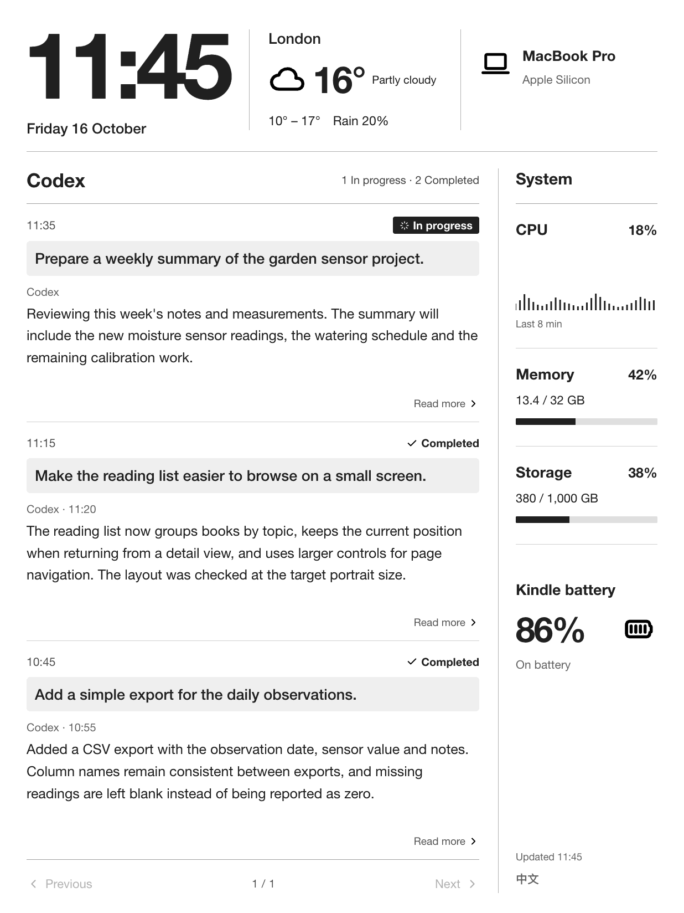

# Kindle Desk

An interactive e-ink dashboard for Kindle and Mac. A large clock, weather, recent Codex questions and replies, Mac resources and Kindle battery level, updated over Bluetooth.

[中文说明](docs/README.zh-CN.md) · [Setup](docs/SETUP.md) · [Protocol](docs/PROTOCOL.md) · [License](LICENSE)

## Downloads

Choose your preferred language:

- [中文版](https://github.com/ff-fdt/kindle-desk-dashboard/releases/latest/download/kindle-desk-zh.zip)
- [English](https://github.com/ff-fdt/kindle-desk-dashboard/releases/latest/download/kindle-desk-en.zip)

Each source package comes with its interface language configured. Follow [Setup](docs/SETUP.md) to run it.

## Interface

- Portrait 1236 × 1648 layout designed for e-ink.
- Time, date and local weather.
- Codex questions and replies with **In progress** and **Completed** turn states.
- Tap a conversation to read the full text, turn pages and return to the overview.
- Swipe down for Kindle's native brightness and warm-light controls.
- Mac CPU, memory and storage, plus Kindle battery level.



## Run the Mac preview

Requires Python 3.10+.

```sh
python3 -m venv .venv
.venv/bin/python -m pip install -r requirements.lock
.venv/bin/python -m playwright install chromium
.venv/bin/python desk.py --port 8791
```

Open **http://127.0.0.1:8791/panel/**.

Copy `config/example.json` to `config/local.json` to configure the city, coordinates, timezone and refresh intervals. `KINDLE_DESK_STATE_DIR` selects the runtime state directory; `KINDLE_DESK_CHROMIUM` selects a Chromium executable. The defaults use London weather and a 15-second refresh.

The device setup uses a jailbroken Paperwhite 5 Signature Edition, firmware 5.18.3, and an Apple Silicon Mac. Build and pairing instructions are in [Setup](docs/SETUP.md).

## How it works

The Mac reads local Codex conversations, collects weather and resource data, and renders the panel as a grayscale PNG. The Kindle receives frames over an authenticated, AES-256-GCM encrypted Bluetooth connection. Touch events travel back to the Mac for page navigation. A GTK/X11 window displays the panel alongside the Kindle's native controls.

The preview runs on `127.0.0.1`. Pairing keys are provisioned over USB. See [Protocol](docs/PROTOCOL.md) and [Data handling](docs/PRIVACY.md) for details.

## Repository map

| Path | Purpose |
| --- | --- |
| `panel/` | Shared HTML/CSS/JS interface |
| `desk.py`, `conversations.py` | Data collectors and local API |
| `panel_render.py`, `mac_metrics.py` | Grayscale rendering and Mac resources |
| `mac/` | Bluetooth peripheral and maintenance UI |
| `kindle/` | BLE client, GTK viewer and lifecycle scripts |
| `scripts/` | Build, launch and packaging tools |
| `tests/` | Collector and device lifecycle tests |
| `docs/` | Setup, protocol and Chinese documentation |
| `examples/` | Sample data for preview images |
| `vendor/` | Upstream helpers and license notices |

## Development

```sh
.venv/bin/python -m pip install pytest
.venv/bin/python -m pytest -q
node --check panel/panel.js
.venv/bin/python scripts/render-demo.py
```

## Credits

Weather: [Open-Meteo](https://open-meteo.com/), [CC BY 4.0](https://creativecommons.org/licenses/by/4.0/). Icons: [Tabler Icons](https://github.com/tabler/tabler-icons), MIT, version 3.34.1.

Renderer/system helpers: [codecube/kindle-mcp-dashboard](https://github.com/codecube/kindle-mcp-dashboard), MIT, commit `aafc74f035597a1fca8ffd39ce1f4c554e8438c2`. Bluetooth: [Sighery/kindlebt](https://github.com/Sighery/kindlebt), MIT, commit `59e1d8e69a52e3cd58cee6fcc416d1774ad55791`; [rxi/log.c](https://github.com/rxi/log.c), MIT, commit `f9ea34994bd58ed342d2245cd4110bb5c6790153`.

Project code uses the [MIT license](LICENSE). Third-party notices are in `vendor/`.
