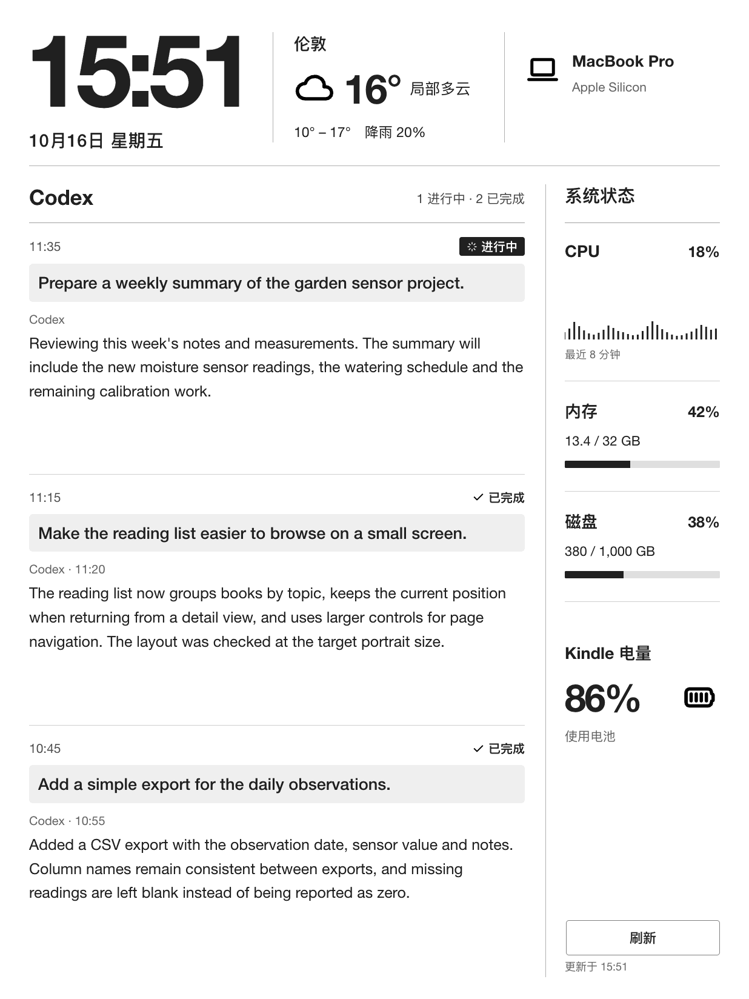

# Kindle Desk

给 Kindle 做的桌面看板：大时钟、天气、Codex 问题与回复、Mac 资源状态和 Kindle 电量，通过蓝牙更新。

[中文版下载](https://github.com/ff-fdt/kindle-desk-dashboard/releases/latest/download/kindle-desk-zh.zip) · [English download](https://github.com/ff-fdt/kindle-desk-dashboard/releases/latest/download/kindle-desk-en.zip)

下载包已配置对应语言，按 [安装说明](SETUP.md) 运行即可。

## 演示



## 快速开始

```sh
python3 -m venv .venv
.venv/bin/python -m pip install -r requirements.lock
.venv/bin/python -m playwright install chromium
.venv/bin/python desk.py --port 8791
```

打开 **http://127.0.0.1:8791/panel/**。

复制 `config/example.json` 为 `config/local.json`，可修改城市、经纬度和时区。默认使用伦敦天气，面板每分钟整点更新；天气每 15 分钟获取一次，手动刷新也会获取新天气。

## 功能

- 竖屏 1236 × 1648，面向墨水屏设计。
- 时间、日期和当地天气。
- 固定显示最新三条 Codex 对话，包括问题、回复和进行中／已完成状态。
- 每分钟整点更新，右下角可手动刷新。
- 电源键或合盖休眠，唤醒后恢复看板并重新连接。
- 顶部下滑打开 Kindle 原生控制栏，调整亮度和暖光。
- Mac CPU、内存、磁盘与 Kindle 电量。

## 运行方式

Mac 读取本机 Codex 对话、天气和资源数据，渲染成灰度图，经加密蓝牙连接发送到 Kindle。看板运行在 GTK/X11 窗口中，原生下拉控制栏继续提供亮度与暖光设置。

开发设备为 Paperwhite 5 Signature Edition，固件 5.18.3，搭配 Apple Silicon Mac。设备编译、配对和启动步骤见 [SETUP](SETUP.md)，数据格式见 [PROTOCOL](PROTOCOL.md)。

## 开源与来源

项目采用 [MIT 许可证](../LICENSE)。天气来自 [Open-Meteo](https://open-meteo.com/)（CC BY 4.0）；图标来自 Tabler Icons。其他依赖与声明见 [Credits](../README.md#credits) 和 `vendor/`。

[版本变化](CHANGELOG.md) · [参与贡献](CONTRIBUTING.md)
